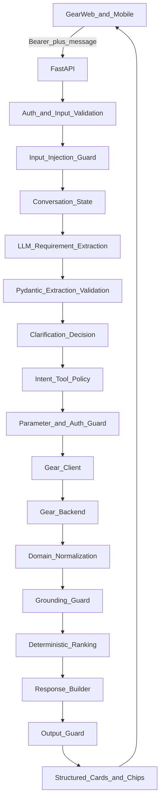

# Gear AI Agent API — High-Level Plan

## Goal

Build one Gear AI Agent API that both User Web and User Mobile call for Smart Car Search and AI Chat. The service interprets natural language, clarifies only when search cannot proceed meaningfully, searches real Gear inventory, returns grounded vehicle cards and follow-up chips, and guides booking/FAQs without inventing platform facts.

Public contract: `POST /api/v1/agent/chat`

Current repo state: FastAPI health baseline in [app/main.py](app/main.py), Groq/OpenAI env keys in [.env.example](.env.example), skeleton notes in [docs/architecture.md](docs/architecture.md). No chat, Gear client, or guardrails yet.

---

## Scope

In scope:

- Real-time chat responses
- Vehicle search and available listings
- Recommendations by type, seats, budget, duration, and related criteria
- Booking process guidance from the documented lifecycle
- FAQs and suggested query chips

Out of scope for now:

- Live GPS tracking
- Vendor-side price comparison in the AI agent
- Agent-executed booking, cancel, payment, or refund
- Hardcoding production API as verified
- Using admin credentials in the AI service
- Guessing unverified Gear field names
- Calling `POST /checkout` from the agent until side-effect-free quote behavior is verified

Provision only (implement when endpoint exists): live booking-status lookup.

---

## Target architecture

Guardrails are **split across the pipeline**, not one sequential box after clarification.



Revised text flow:

```text
Web / Mobile
  -> FastAPI
  -> Auth + Input Validation
  -> Input / Injection Guard
  -> Conversation State
  -> LLM Requirement Extraction
  -> Pydantic Validation
  -> Clarification Decision
  -> Intent / Tool Policy
  -> Parameter + Auth Guard
  -> Gear Client
  -> Gear Backend
  -> Domain Normalization
  -> Grounding Guard
  -> Deterministic Ranking
  -> Response Builder
  -> Output Guard
  -> Structured Cards + Chips
```

Auth model:

```text
User logs in on Web/Mobile
  -> client sends user Bearer token
  -> AI API forwards token to Gear
  -> never to LLM, prompts, or logs
```

AI service uses its own `GROQ_API_KEY` and later `OPENAI_API_KEY`. Never admin Gear credentials.

**LLM authority boundary (explicit):** The LLM may propose an intent/tool name and structured arguments, but server-side orchestration performs all authorization, validation, catalog resolution, and actual HTTP execution. The model never performs arbitrary HTTP or direct Gear calls.

```text
LLM proposes: search_available_cars + args
  -> SERVER validates
  -> SERVER calls Gear
```

---

## Conversation Experience

Required layer. Style: marketplace search assistant (Honeymoon Events-like), not a generic chatbot.

Behavior:

1. User states need in natural language
2. Agent extracts into a **canonical search state** with confirmed vs preferences vs missing
3. Clarification only if missing data **blocks meaningful search**
4. Search real Gear inventory via server-executed tools
5. Backend ranks candidates deterministically from API-returned attributes
6. LLM may explain why top candidates fit; it does not invent which car is best without score/data support
7. Return structured vehicle cards and **grounded** suggestion chips
8. Remember prior confirmed filters; refinements merge without repeating the full query
9. Continuous flow: search to recommendation to detail to booking guidance

### Canonical search state

Distinguish confirmed filters, inferred preferences, and missing required fields so LLM inference is never treated as a hard user requirement.

```json
{
  "confirmed": {
    "vehicle_type": "SUV",
    "max_budget": 800
  },
  "preferences": {
    "family_friendly": true
  },
  "missing": [
    "from_date"
  ]
}
```

Example: "family car" sets `preferences.family_friendly = true`. It does **not** automatically become confirmed `seats = 7`.

### Clarification policy

Do not ask a question for every missing filter.

- If search can proceed meaningfully (e.g. "Show me SUVs") → search general inventory
- If availability/price claim cannot be verified without a field (e.g. duration without start date) → clarify once
- Rule of thumb: **Search can proceed → search; availability/price cannot be verified → clarify**

### Session rules

- Merge new confirmed constraints into last search
- Explicit correction replaces prior confirmed value
- Preferences may influence ranking soft signals, not hard filters, until user confirms
- New search clears criteria
- Sessions isolated per user with expiry
- **`session_id` must be bound to authenticated user identity** — User B cannot resume User A's session even if the ID leaks
- In-memory sessions for local/dev only; persistent store chosen before production

---

## Package layout

Expand current `app/` into:

- `app/api/v1/` — health, chat, router
- `app/schemas/` — API request/response DTOs only
- `app/domain/` — platform-independent models: `search_state.py`, `vehicle.py`, `recommendation.py`, `conversation.py`
- `app/agent/` — orchestrator, intent, extractor, prompts, response_builder, clarification
- `app/tools/` — registry plus vehicle_search, details, availability, locations, catalog; `calculate_checkout_quote` registered but **disabled until verified**
- `app/guardrails/` — input, injection, intent, tool, auth, parameter, action, data/grounding, output, policy (invoked at the correct pipeline stages)
- `app/clients/` — gear_client (raw HTTP + adapters into domain), llm_client provider interface
- `app/services/` — session, recommendation, catalog, faq
- `app/security/` — auth extraction, token forwarding, rate limit, PII redaction
- `app/exceptions/` and `app/utils/`
- `tests/unit|integration|security/`
- `scripts/inspect_gear_api.py` for staging smoke once URL/token arrive

Domain boundary:

```text
Gear API JSON
  -> Gear Client / Adapter
  -> Domain Vehicle
  -> Agent / Ranking
```

Raw Gear response dictionaries must not travel through agent/ranking/response layers. Field renames (e.g. `car_name` to `title`) change only the adapter.

---

## Guardrail policy (by stage)

| Stage | Guards |
|---|---|
| Pre-LLM | Auth, input schema, size/language, injection |
| Post-extraction | Pydantic validation of proposed intent/args/search state |
| Pre-tool | Intent allowlist, tool allowlist, parameter validation, auth required for authenticated Gear ops |
| Post-Gear | Data grounding — only domain fields from Gear may appear as facts |
| Pre-response | Output schema validation; grounded chips only |

Rules:

- Intent allowlist: search, recommendation, details, availability, pricing (when quote tool enabled), locations, booking_guidance, faq
- Tool: only registered tools; no arbitrary endpoints, SQL, or admin ops
- Action: no state-changing booking/cancel/pay without a future explicit confirm flow
- Data: LLM cannot invent cars, prices, availability, ratings, discounts, driver, or booking status
- On Gear or LLM outage: controlled `unavailable` / error code — never guessed inventory

---

## Ranking and chips

Recommended split:

```text
LLM: understand user preference
Backend: rank candidates deterministically
LLM: explain why top candidates fit (optional copy)
```

Model must not declare "Car A is best" without ranking score/data support.

Suggested chips (With driver, Deals, 7 seats, Automatic, Fuel efficient, etc.) only when the corresponding capability/field is confirmed from catalog or result data. No false UX affordances.

---

## LLM strategy

- Dev/test now: `LLM_PROVIDER=groq` plus `GROQ_API_KEY` and `GROQ_MODEL` (already in `.env.example`)
- Later: OpenAI via `OPENAI_API_KEY` / `OPENAI_MODEL` behind the same `LLMProvider` interface
- LLM proposes structured extraction only; server owns tool execution
- Validate every model output with Pydantic; conversation memory lives in our session service

---

## Gear integration boundaries

Client owns base URL plus prefix, timeouts, bearer forwarding, error translation, and mapping into domain models.

Known Postman surface:

- Public or optional auth: car listing search
- Auth: available cars, details, dropdown/catalog, availability check, default locations
- Checkout endpoint: expose in registry only as `calculate_checkout_quote`. Until developer confirms `POST /checkout` is side-effect-free calculation only: **DO NOT CALL FROM AGENT**

Do not hardcode `https://gearapp.ae/Gear/api` as verified staging. Wait for developer:

1. Exact staging `GEAR_API_BASE_URL`
2. Dedicated customer test token or account

Until then: fixture-based development; never present fixtures as live results.

---

## Chat API contract v1

Request: `message`, optional `session_id`, `locale`, optional client context such as coordinates. Bearer in `Authorization` header only.

Response: `session_id`, `status` in clarification/results/unavailable, `message`, `vehicles`, `suggestions`.

Vehicle card fields: only keys present on domain models after Gear adaptation; unknown price or availability stays unknown.

---

## Observability

Do not wait until Phase 6 for all logging. From Phase 1/2 minimum structured fields:

- `request_id`
- `session_id`
- intent
- clarification/result status
- tool name
- tool status
- latency

Do **not** log message bodies by default in production. Never log Bearer tokens, passwords, payment data, or unnecessary PII.

Phase 6 adds persistent metrics, rate-limit dashboards, and fuller operational alerting.

---

## Delivery phases and gates

### Phase 0 — Baseline (largely done)

Health app, venv docs, `.env.example`, gitignore. Gate: `/health` runs locally.

### Phase 1 — Config and contract

Typed settings, provider selection, `app/domain/` stubs, API chat request/response schemas, chat stub returning schema-valid placeholder, `request_id` logging skeleton, OpenAPI examples. Gate: missing LLM/Gear secrets do not break health; chat validates payloads.

### Phase 2 — Conversation foundation without live Gear

Groq adapter, structured extraction + Pydantic validation, canonical search state (confirmed/preferences/missing), conditional clarification, session merge/correction with **user-bound session_id**, fixture inventory, structured logs for intent/status. Gate: unit tests for retention, correction, new-search clear, family-car preference vs confirmed seats, malformed model output, session cross-user rejection.

### Phase 3 — Guardrails and tool registry

Split guards wired at correct stages; allowlisted tools on fixtures; `calculate_checkout_quote` present in registry but disabled/blocked until side-effect verification. Gate: injection/auth/tool/parameter/grounding unit and security tests pass.

### Phase 4 — Live Gear read path

`gear_client` plus adapters to domain; live read tools; staging smoke via script once URL/token arrive; catalog resolution before search; enable `calculate_checkout_quote` only after quote-only confirmation. Gate: staging smoke for search/availability/details/locations; grounded domain cards only.

### Phase 5 — Ranking and full UX

Deterministic ranking on verified attributes; grounded chips; LLM explain-only copy; booking guidance as lifecycle FAQ not live status; FAQ service. Gate: end-to-end scenario (family car → area → refine seats/budget) returns updated cards with preference vs confirmed handling.

### Phase 6 — Hardening and release

Persistent sessions and retention, rate limits, fuller metrics, Web and Mobile contract check, OpenAI adapter smoke in staging, security suite.

---

## Implementation order when coding starts

1. Project structure under `app/` including `domain/`, plus config and request_id logging
2. Schemas and API router for health and chat stub
3. LLM provider interface and Groq adapter
4. Session (user-bound), clarification policy, extraction into canonical search state
5. Split guardrail package and tool registry (`calculate_checkout_quote` disabled)
6. Gear client adapters and vehicle tools from fixtures to staging
7. Orchestrator wiring full staged guarded flow
8. Deterministic recommendation and grounded output builder
9. FAQ and booking guidance
10. Security and integration tests
11. Docker/ops when approaching deploy

**First coding slice after plan approval:** Phase 1 only — structure, config, domain/API schemas, chat stub, request_id logging skeleton. No agent intelligence yet.

---

## External blockers

- Staging API base URL
- Dedicated customer test credentials or token
- Sample payloads for driver, deals, and seats fields
- Confirmation that `POST /checkout` is quote-only with no booking/payment side effect (required before enabling `calculate_checkout_quote`)

---

## Success criteria

- Same AI API serves Web and Mobile
- Natural-language search with conditional clarification and context retention
- Confirmed filters distinct from inferred preferences
- Results grounded in Gear inventory via domain models only
- Deterministic ranking; LLM explains, does not invent best car
- Suggestion chips only when fields/capabilities confirmed
- Sessions bound to authenticated user identity
- Booking guidance and FAQs without claiming live status without an API
- Groq for development; switchable to OpenAI later
- Tokens and secrets never in prompts, responses, git, or logs
- Early structured observability without default message-body logging
